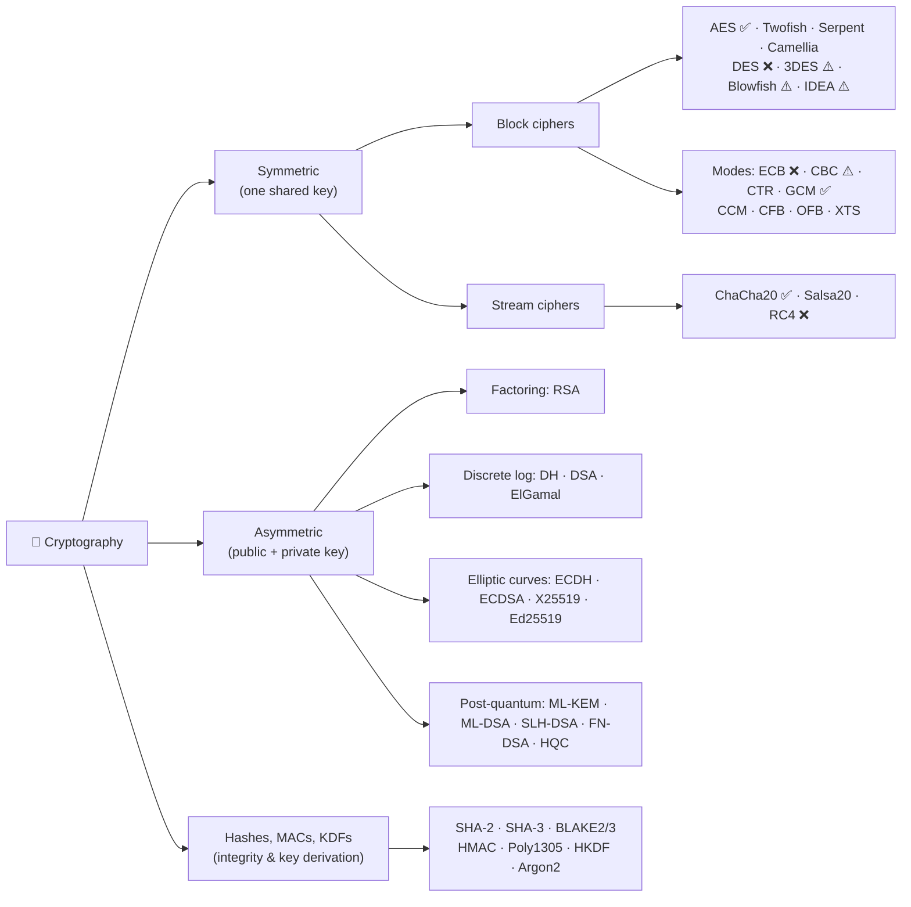

# 🔐 Cryptography Algorithms: A Visual Guide

> How the major symmetric, asymmetric and post-quantum algorithms work, how they differ, and why the strong ones are strong.

**Status legend:** ✅ Recommended  ·  ⚠️ Legacy / use with care  ·  ❌ Broken / do not use

---

## 📑 Contents

| # | Topic | What's inside |
|---|---|---|
| 1 | **Symmetric** | [Block ciphers](docs/01-symmetric/block-ciphers.md) (AES, DES, 3DES, Blowfish, Twofish, IDEA, Serpent, Camellia…) · [Modes of operation](docs/01-symmetric/modes-of-operation.md) (ECB, CBC, CTR, GCM, CCM, XTS…) · [Stream ciphers](docs/01-symmetric/stream-ciphers.md) (RC4, Salsa20, ChaCha20) |
| 2 | **Asymmetric** | [Overview](docs/02-asymmetric/overview.md) · [RSA](docs/02-asymmetric/rsa.md) · [Diffie-Hellman](docs/02-asymmetric/diffie-hellman.md) · [ECC: ECDH, ECDSA, Ed25519](docs/02-asymmetric/ecc.md) · [ElGamal & DSA](docs/02-asymmetric/elgamal-and-dsa.md) |
| 3 | **Post-quantum** | [Overview & LWE](docs/03-post-quantum/overview.md) · [Key encapsulation & ML-KEM](docs/03-post-quantum/ml-kem.md) · [PQ signatures: ML-DSA, SLH-DSA](docs/03-post-quantum/pq-signatures.md) · [Hybrid PQ](docs/03-post-quantum/hybrid.md) |
| 4 | **Supporting primitives** | [Hashes, MACs, KDFs, password hashing](docs/04-supporting-primitives.md) |
| 5 | **TLS** | [TLS 1.2 vs TLS 1.3 handshakes](docs/05-tls.md) |
| 6 | **Comparisons** | [Master comparison tables & what to use today](docs/06-comparisons.md) |

---

## 🗺️ The Big Picture

| | Symmetric | Asymmetric |
|---|---|---|
| **Keys** | One shared secret key | Key pair: public + private |
| **Speed** | ⚡ Very fast (often hardware-accelerated) | 🐢 100–1000× slower |
| **Main problem solved** | Bulk data confidentiality | Key distribution, digital signatures |
| **Main weakness** | How do both sides get the key securely? | Too slow for bulk data |
| **Typical key size for ~128-bit security** | 128 bits | RSA 3072 bits / ECC 256 bits |
| **Examples** | AES, ChaCha20 | RSA, ECDH, Ed25519, ML-KEM |

> 💡 **In practice they are combined (hybrid encryption):** asymmetric crypto agrees on a key, symmetric crypto encrypts the data. That is exactly what TLS, SSH, Signal and PGP do.

---

## ✏️ Editing this guide

- Each topic lives in its own file under [`docs/`](docs/), so edit only the file you need.
- Diagrams are written in [Mermaid](https://mermaid.js.org/). Paste a diagram block into [mermaid.live](https://mermaid.live) to edit it visually, then paste it back.
- On github.com, press <kbd>.</kbd> in the repo to open a VS Code editor in the browser. Locally, VS Code with the *Markdown Preview Mermaid Support* extension shows a live preview.
- Adding an algorithm? Add a section to the matching file (or a new file) and a link in the table above.

*Contributions and corrections welcome. Open an issue or pull request.*
