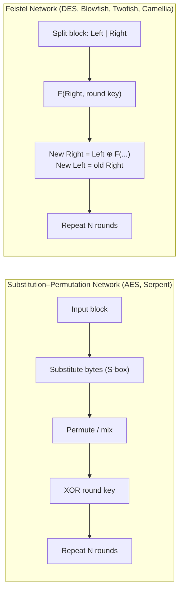
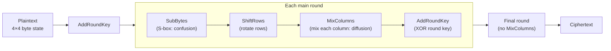

# 🔑 Symmetric Cryptography: Block Ciphers

[🏠 Back to index](../../README.md)  ·  **Status legend:** ✅ Recommended  ·  ⚠️ Legacy / use with care  ·  ❌ Broken / do not use

---

The **same key** encrypts and decrypts. Security rests on two ideas from Claude Shannon:

- **Confusion:** the relationship between key and ciphertext is complex (achieved with substitution / S-boxes).
- **Diffusion:** changing one plaintext bit changes about half the ciphertext bits (achieved with permutation / mixing).

Most block ciphers are built in one of two ways:

A Feistel network's nice property: decryption is the same circuit with the round keys reversed, so the round function `F` does not even need to be invertible.

Block ciphers encrypt a **fixed-size block** (64 or 128 bits) at a time.

## ✅ AES (Advanced Encryption Standard), also called Rijndael

| Block | Key sizes | Rounds | Structure | Year |
|---|---|---|---|---|
| 128 bits | 128 / 192 / 256 | 10 / 12 / 14 | SPN | 2001 (NIST FIPS 197) |

**How it works:** the 16-byte block is arranged as a 4×4 grid of bytes (the *state*). Each round applies four steps:

1. **SubBytes:** every byte is replaced via a fixed lookup table built from inversion in the field GF(2⁸). This is the non-linear part.
2. **ShiftRows:** row *i* is rotated left by *i* bytes, spreading bytes across columns.
3. **MixColumns:** each column is multiplied by a fixed matrix, so every output byte depends on all four input bytes.
4. **AddRoundKey:** XOR with a round key derived from the main key by the key schedule.

**Why it's robust:** after just two rounds every output bit depends on every input bit. The best known attacks on full AES barely beat brute force (biclique attacks shave off about 2 bits). AES-NI instructions in modern CPUs make it extremely fast and also resistant to cache-timing attacks. AES-256 also keeps a comfortable margin against quantum computers (see [Post-Quantum](../03-post-quantum/overview.md)).

## ❌ DES (Data Encryption Standard)

| Block | Key | Rounds | Structure | Year |
|---|---|---|---|---|
| 64 bits | 56 bits (64 with parity) | 16 | Feistel | 1977 |

**How it works:** initial permutation, then 16 Feistel rounds. The `F` function expands the 32-bit half to 48 bits, XORs a 48-bit round key, passes the result through eight S-boxes (6 bits in, 4 bits out), and permutes the output.

**Why it fell:** the design is actually clever (its S-boxes were hardened against differential cryptanalysis years before that attack was public), but a **56-bit key is too small**. In 1998 the EFF's "Deep Crack" machine brute-forced a DES key in about 56 hours; today it takes hours on rented hardware.

## ⚠️ 3DES (Triple DES / TDEA)

Applies DES three times: **Encrypt(K1) → Decrypt(K2) → Encrypt(K3)** (EDE). With K1 = K2 = K3 it is backward-compatible with single DES.

- Nominal key 168 bits, but meet-in-the-middle attacks reduce effective security to about **112 bits**.
- Still a **64-bit block**, which makes it vulnerable to the **Sweet32** birthday attack (2016): after about 32 GB under one key, block collisions leak plaintext.
- Three times slower than DES. NIST disallowed it for encryption after 2023.

## ⚠️ Blowfish

| Block | Key | Rounds | Structure | Year |
|---|---|---|---|---|
| 64 bits | 32–448 bits | 16 | Feistel | 1993 (Bruce Schneier) |

**How it works:** the key is used to generate large **key-dependent S-boxes** (four tables of 256 × 32-bit entries). The key setup is deliberately slow, which is why Blowfish lives on inside **bcrypt** for password hashing.

**Weakness:** the 64-bit block makes it Sweet32-vulnerable for large data, and weak keys exist. Schneier himself recommends Twofish or AES instead.

## ✅ Twofish

| Block | Key | Rounds | Structure | Year |
|---|---|---|---|---|
| 128 bits | 128 / 192 / 256 | 16 | Feistel | 1998 (AES finalist) |

Successor to Blowfish with key-dependent S-boxes, a Maximum Distance Separable (MDS) matrix for diffusion, and a Pseudo-Hadamard Transform to mix the two halves. **No practical attack on full Twofish exists.** It lost the AES competition mainly on speed and hardware cost, not security.

## ⚠️ IDEA (International Data Encryption Algorithm)

| Block | Key | Rounds | Year |
|---|---|---|---|
| 64 bits | 128 bits | 8.5 | 1991 |

**How it works:** security comes from mixing **three incompatible algebraic operations** on 16-bit words: XOR, addition mod 2¹⁶, and multiplication mod 2¹⁶ + 1. Because no single algebra describes all three, the cipher resists linear and differential analysis.

Used in early PGP. Not broken in practice, but the 64-bit block and the existence of weak-key classes make it legacy.

## ➕ Added: other notable block ciphers

| Cipher | Block | Key | Structure | Notes |
|---|---|---|---|---|
| **Serpent** ✅ | 128 | 128/192/256 | SPN, 32 rounds | AES runner-up; very conservative security margin, slower |
| **Camellia** ✅ | 128 | 128/192/256 | Feistel, 18/24 rounds | Japanese standard, security comparable to AES, supported in TLS and ISO |
| **ARIA** ✅ | 128 | 128/192/256 | SPN | South Korean national standard |
| **SM4** ✅ | 128 | 128 | Unbalanced Feistel, 32 rounds | Chinese national standard (used in Chinese TLS/WAPI) |
| **RC5 / RC6** ⚠️ | 32–128 | up to 2040 | ARX, data-dependent rotations | RC6 was an AES finalist |
| **CAST-128** ⚠️ | 64 | 40–128 | Feistel | Older PGP default; 64-bit block |

---

🏠 [Index](../../README.md)  ·  [🔗 Modes of Operation](modes-of-operation.md) ➡️
