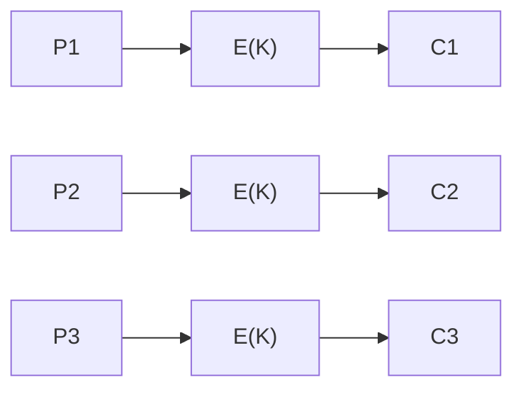
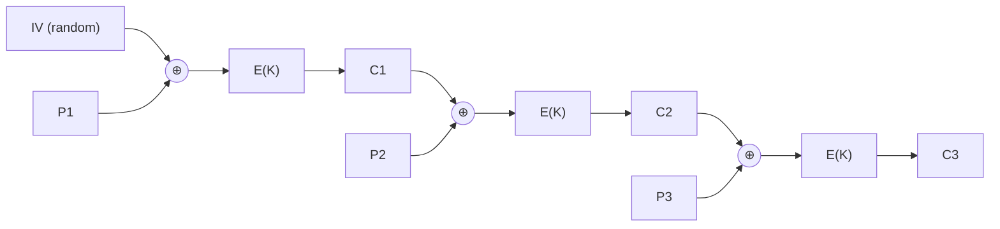
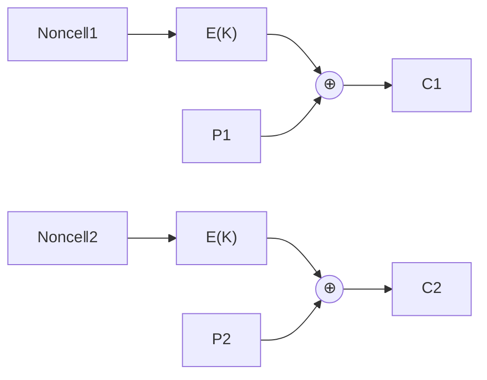
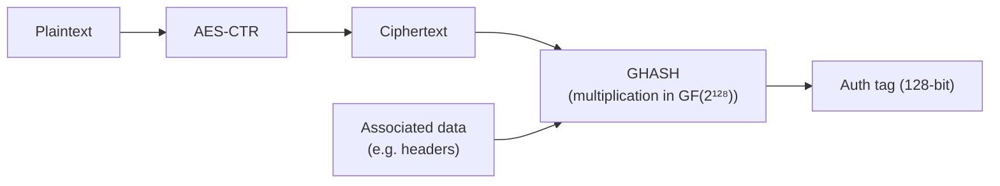

# 🔗 Modes of Operation

[🏠 Back to index](../../README.md)  ·  **Status legend:** ✅ Recommended  ·  ⚠️ Legacy / use with care  ·  ❌ Broken / do not use

---

A block cipher alone only encrypts one block. A **mode** defines how to encrypt messages longer than a block and how blocks are chained.

## ❌ ECB (Electronic Codebook)

Each block is encrypted independently: `Cᵢ = E(K, Pᵢ)`.

**Problem:** identical plaintext blocks produce identical ciphertext blocks, so patterns leak. The famous "ECB penguin" image, encrypted in ECB, is still clearly recognizable. **Never use for real data.**

## ⚠️ CBC (Cipher Block Chaining)

Each plaintext block is XORed with the previous ciphertext block before encryption: `Cᵢ = E(K, Pᵢ ⊕ Cᵢ₋₁)`, with `C₀ = IV`.

- ✅ Hides patterns, if the IV is **random and unpredictable**.
- ❌ Encryption is sequential (cannot be parallelized); needs padding.
- ❌ No integrity, so it is vulnerable to **padding oracle attacks** (POODLE, Lucky13) unless combined carefully with a MAC. This is why TLS 1.3 removed it.

## CTR (Counter Mode)

Turns a block cipher into a stream cipher: encrypt a counter to produce a keystream, then XOR with plaintext. `Cᵢ = Pᵢ ⊕ E(K, Nonce ‖ i)`.

- ✅ Fully parallel, random access, no padding.
- ❌ **Nonce reuse is catastrophic:** two messages under the same key and nonce give `C1 ⊕ C2 = P1 ⊕ P2`.
- ❌ No integrity on its own.

## ✅ GCM (Galois/Counter Mode), an AEAD mode

**GCM = CTR mode for encryption + GHASH for authentication.** It is an *AEAD* (Authenticated Encryption with Associated Data) mode: it provides confidentiality **and** integrity, and can also authenticate unencrypted headers (the "associated data").

- ✅ Fast (parallel, hardware-accelerated with AES-NI + CLMUL), tamper-evident.
- ⚠️ Uses a 96-bit nonce that must **never** repeat per key; reuse breaks both confidentiality and authentication. AES-GCM-SIV is a nonce-misuse-resistant alternative.

## ➕ Added: other modes

| Mode | Type | Notes |
|---|---|---|
| **CCM** | AEAD | CTR + CBC-MAC. Common in IoT, Bluetooth LE, Wi-Fi WPA2; allowed in TLS 1.3 |
| **CFB** (Cipher Feedback) | Stream-like | Self-synchronizing; legacy |
| **OFB** (Output Feedback) | Stream-like | Keystream independent of plaintext; legacy |
| **XTS** | Disk encryption | Used by BitLocker, FileVault, LUKS; designed for sector-based storage, no integrity |
| **GCM-SIV** | AEAD | Nonce-misuse resistant: reusing a nonce only reveals whether messages were identical |

## Modes compared

| Mode | Confidentiality | Integrity | Parallel encrypt | Needs padding | Verdict |
|---|---|---|---|---|---|
| ECB | ❌ (leaks patterns) | ❌ | ✅ | ✅ | ❌ Never |
| CBC | ✅ | ❌ | ❌ | ✅ | ⚠️ Legacy |
| CTR | ✅ | ❌ | ✅ | ❌ | Needs a MAC |
| GCM | ✅ | ✅ | ✅ | ❌ | ✅ Default |
| CCM | ✅ | ✅ | ❌ | ❌ | ✅ Constrained devices |

---

⬅️ [🔑 Symmetric Cryptography: Block Ciphers](block-ciphers.md)  ·  🏠 [Index](../../README.md)  ·  [🌊 Stream Ciphers](stream-ciphers.md) ➡️
