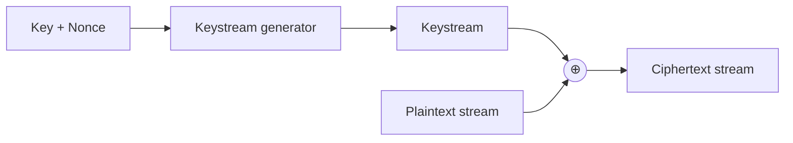

# 🌊 Stream Ciphers

[🏠 Back to index](../../README.md)  ·  **Status legend:** ✅ Recommended  ·  ⚠️ Legacy / use with care  ·  ❌ Broken / do not use

---

Stream ciphers generate a pseudo-random **keystream** from a key and nonce, then XOR it with the data one bit or byte at a time. Ideal for continuous streams, network traffic and devices without AES hardware.



> ⚠️ Golden rule for every stream cipher: **never reuse a (key, nonce) pair.**

## ❌ RC4

Designed in 1987. A 256-byte state array is shuffled by the key (KSA), then a pseudo-random generator (PRGA) outputs bytes. Simple and fast, but the **first output bytes are statistically biased**, which leaked keys in **WEP** Wi-Fi and enabled plaintext recovery in TLS. RFC 7465 (2015) prohibits RC4 in TLS.

## Salsa20

Designed by Daniel J. Bernstein (2005) and selected for the eSTREAM portfolio. Works on a 4×4 matrix of 32-bit words (constants, 256-bit key, nonce, counter) and runs 20 rounds of **ARX** operations: **A**dd, **R**otate, **X**OR. XSalsa20 extends the nonce to 192 bits (used in NaCl/libsodium).

## ✅ ChaCha20

An improved variant of Salsa20 with better diffusion per round. Same 4×4 state:

```
 ┌──────────┬──────────┬──────────┬──────────┐
 │ const    │ const    │ const    │ const    │   "expand 32-byte k"
 ├──────────┼──────────┼──────────┼──────────┤
 │ key      │ key      │ key      │ key      │   256-bit key
 ├──────────┼──────────┼──────────┼──────────┤
 │ key      │ key      │ key      │ key      │
 ├──────────┼──────────┼──────────┼──────────┤
 │ counter  │ nonce    │ nonce    │ nonce    │   32-bit counter, 96-bit nonce
 └──────────┴──────────┴──────────┴──────────┘
```

The core is the **quarter-round**, applied to columns then diagonals for 20 rounds:

```
a += b; d ^= a; d <<<= 16;
c += d; b ^= c; b <<<= 12;
a += b; d ^= a; d <<<= 8;
c += d; b ^= c; b <<<= 7;
```

**Why it's robust:** ARX operations run in constant time on any CPU (no lookup tables, so no cache-timing leaks), and it is very fast in software, which is why it's preferred on mobile devices without AES hardware. Paired with the **Poly1305** MAC as **ChaCha20-Poly1305**, it is an AEAD used in TLS 1.3, WireGuard, SSH and Signal.

## Stream ciphers compared

| Cipher | Key | Nonce | Design | Status |
|---|---|---|---|---|
| RC4 | 40–2048 bits | none (!) | Byte-array shuffling | ❌ Broken |
| Salsa20 | 128/256 | 64 (XSalsa: 192) | ARX, 20 rounds | ✅ Secure |
| ChaCha20 | 256 | 96 (XChaCha: 192) | ARX, 20 rounds, better diffusion | ✅ Recommended |

---

⬅️ [🔗 Modes of Operation](modes-of-operation.md)  ·  🏠 [Index](../../README.md)  ·  [🗝️ Asymmetric Cryptography: Overview](../02-asymmetric/overview.md) ➡️
