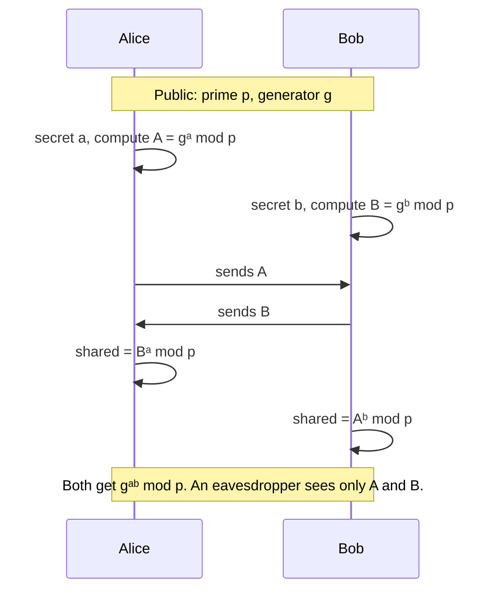

# Diffie-Hellman (DH, 1976)

[🏠 Back to index](../../README.md)  ·  **Status legend:** ✅ Recommended  ·  ⚠️ Legacy / use with care  ·  ❌ Broken / do not use

---

Not for encrypting messages; it lets two parties **agree on a shared secret over a public channel**.



<details>
<summary>🧮 Toy example</summary>

```
p = 23, g = 5
Alice: a = 6  → A = 5^6  mod 23 = 8
Bob:   b = 15 → B = 5^15 mod 23 = 19
Alice: 19^6  mod 23 = 2
Bob:   8^15  mod 23 = 2   ✅ shared secret = 2
```
</details>

**Why it's robust:** recovering `a` from `gᵃ mod p` is the discrete logarithm problem.

**Pitfalls:** plain DH is **unauthenticated**, so a man-in-the-middle can run two separate exchanges. It must be combined with signatures or certificates. Small or shared groups enable attacks like Logjam (2015); use ≥ 2048-bit groups or, better, elliptic curves. **Ephemeral** DH (DHE/ECDHE, fresh keys per session) gives **forward secrecy**: stealing the server's long-term key later doesn't decrypt past traffic.

---

⬅️ [RSA (Rivest–Shamir–Adleman, 1977)](rsa.md)  ·  🏠 [Index](../../README.md)  ·  [Elliptic Curve Cryptography (ECC)](ecc.md) ➡️
