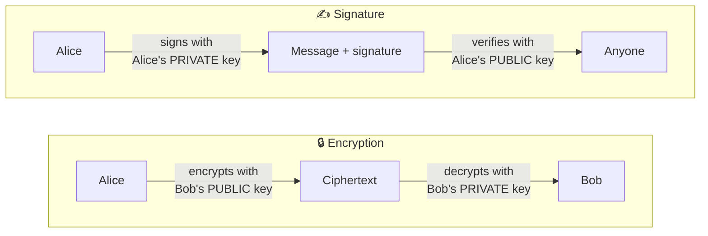

# 🗝️ Asymmetric Cryptography: Overview

[🏠 Back to index](../../README.md)  ·  **Status legend:** ✅ Recommended  ·  ⚠️ Legacy / use with care  ·  ❌ Broken / do not use

---

Uses a **mathematically linked key pair**. The public key can be shared with anyone; the private key never leaves its owner.

Security rests on **trapdoor problems**: easy to compute one way, infeasible to reverse without a secret.

| Hard problem | Algorithms | Broken by quantum (Shor)? |
|---|---|---|
| Integer factorization | RSA | ✅ Yes |
| Discrete logarithm (mod p) | DH, DSA, ElGamal | ✅ Yes |
| Elliptic-curve discrete log | ECDH, ECDSA, EdDSA | ✅ Yes |
| Lattice problems (Module-LWE) | ML-KEM, ML-DSA | ❌ No (as far as known) |
| Hash function security | SLH-DSA | ❌ No |

---

⬅️ [🌊 Stream Ciphers](../01-symmetric/stream-ciphers.md)  ·  🏠 [Index](../../README.md)  ·  [RSA (Rivest–Shamir–Adleman, 1977)](rsa.md) ➡️
