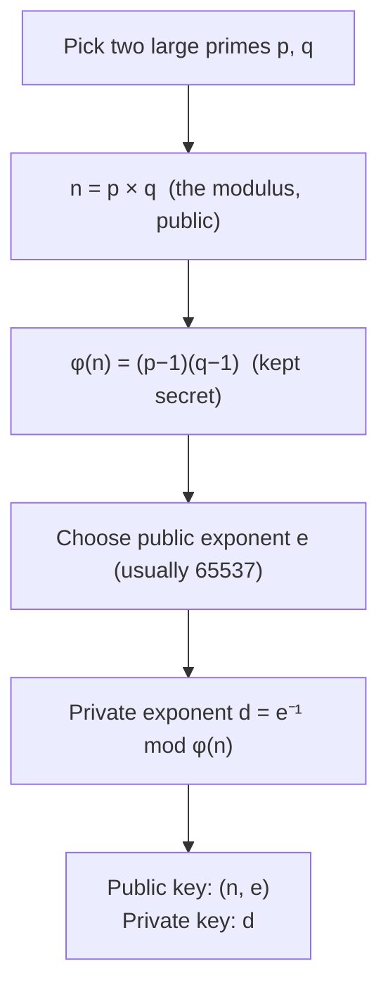

# RSA (Rivest–Shamir–Adleman, 1977)

[🏠 Back to index](../../README.md)  ·  **Status legend:** ✅ Recommended  ·  ⚠️ Legacy / use with care  ·  ❌ Broken / do not use

---

Used for **encryption and signatures**. Based on the difficulty of **factoring** a large number into its two prime factors.



- **Encrypt:** `c = mᵉ mod n`
- **Decrypt:** `m = cᵈ mod n`
- **Sign:** `s = hash(m)ᵈ mod n` · **Verify:** check `sᵉ mod n == hash(m)`

<details>
<summary>🧮 Toy example (click to expand)</summary>

```
p = 61, q = 53
n = 61 × 53 = 3233
φ(n) = 60 × 52 = 3120
e = 17
d = 2753          (because 17 × 2753 = 46801 = 15 × 3120 + 1)

Encrypt m = 65:   c = 65^17   mod 3233 = 2790
Decrypt:          m = 2790^2753 mod 3233 = 65 ✅
```
Real RSA uses primes of 1536+ bits each.
</details>

**Why it's robust:** nobody knows how to factor a well-chosen 2048-bit modulus with classical computers; the record is 829 bits (RSA-250, 2020).

**Pitfalls:** "textbook" RSA is insecure. Always use padding: **OAEP** for encryption and **PSS** for signatures. The older PKCS#1 v1.5 encryption padding enabled Bleichenbacher/ROBOT attacks. Keys must be ≥ 2048 bits (3072 for long-term). RSA is slow and its keys are large, which is why ECC has largely replaced it in new designs.

---

⬅️ [🗝️ Asymmetric Cryptography: Overview](overview.md)  ·  🏠 [Index](../../README.md)  ·  [Diffie-Hellman (DH, 1976)](diffie-hellman.md) ➡️
