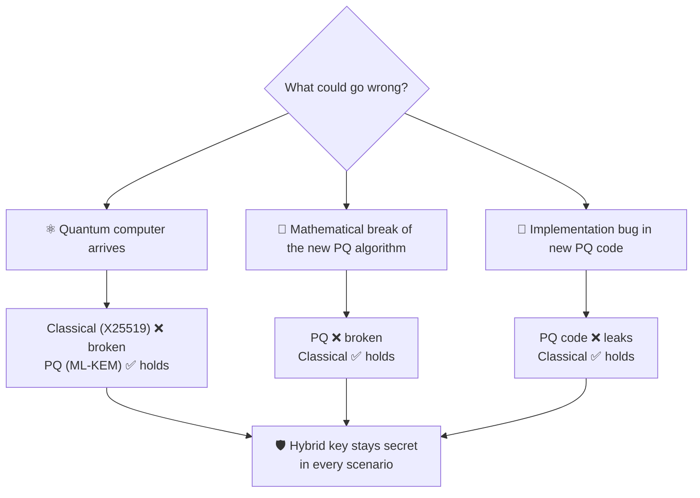
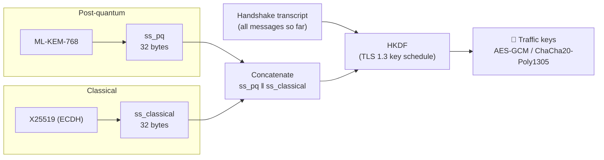
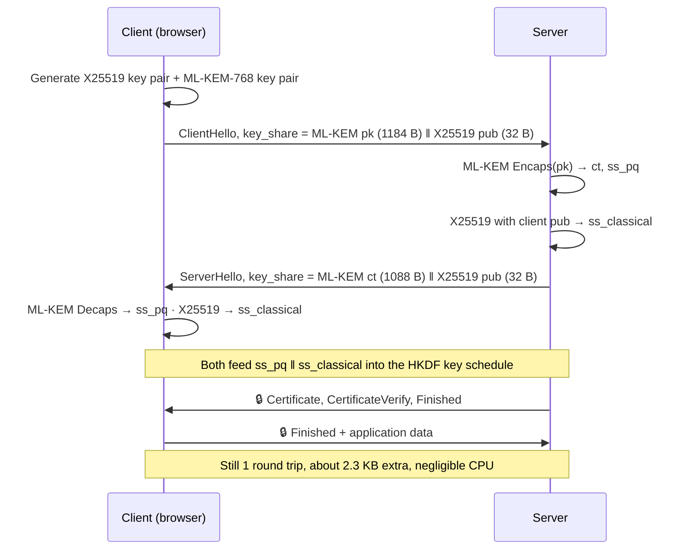
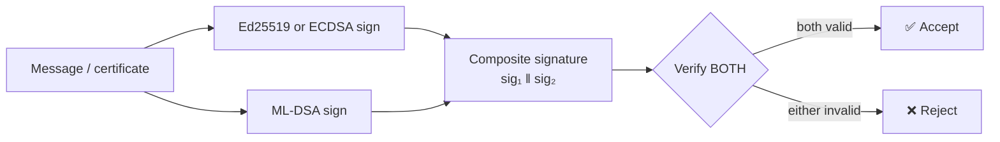
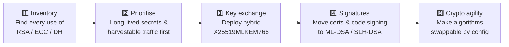

# 🔀 Hybrid Post-Quantum Cryptography

[🏠 Back to index](../../README.md)  ·  **Status legend:** ✅ Recommended  ·  ⚠️ Legacy / use with care  ·  ❌ Broken / do not use

---

**Hybrid** means running a **classical** algorithm and a **post-quantum** algorithm *together*, and combining their outputs so the result is secure as long as **at least one** of them is unbroken.

## Why bother with two algorithms?

This is not hypothetical. **SIKE**, a post-quantum KEM that reached NIST's 4th round, was broken in 2022 by a *classical* attack that recovered keys in about an hour on a single laptop core. **Rainbow**, a signature finalist, was broken the same year. Anyone who had deployed those alone would have lost everything; hybrid users would still have been protected by ECDH.

| Threat | Classical only | PQ only | **Hybrid** |
|---|---|---|---|
| Future quantum computer | ❌ | ✅ | ✅ |
| Classical break of PQ math (like SIKE) | ✅ | ❌ | ✅ |
| Bug in new PQ implementation | ✅ | ❌ | ✅ |
| Compliance (FIPS-validated classical + PQ) | ✅ | ⚠️ | ✅ |
| Extra bandwidth | none | ~2.2 KB | ~2.3 KB |

## How the two secrets are combined (the "combiner")

Because the KDF mixes **both** secrets, an attacker who recovers only one of them still faces a random-looking input. Binding the transcript prevents an attacker from mixing parts of different handshakes.

## Hybrid TLS 1.3 handshake: `X25519MLKEM768`

The client's key share grows from 32 bytes to 1,216 bytes, which occasionally exceeds a single TCP packet. Old middleboxes that mishandled large ClientHellos were the main deployment hiccup.

## Hybrid signatures and certificates

Key exchange is the urgent part, but signatures can be hybrid too. A **composite signature** contains both a classical and a PQ signature, and verification succeeds only if **both** are valid.

The protection works the same way as for key exchange: a forger must break **both** Ed25519/ECDSA **and** ML-DSA to produce an accepted signature. The trade-off is size: an Ed25519 + ML-DSA-44 composite signature is about 2.5 KB instead of 64 bytes.

## Who uses hybrid PQ today

| System | Hybrid scheme | Notes |
|---|---|---|
| **TLS 1.3** (Chrome, Firefox, Edge, Safari, Cloudflare, OpenSSL 3.5+) | `X25519MLKEM768` | On by default in major browsers |
| **OpenSSH** | `mlkem768x25519-sha256` (earlier `sntrup761x25519-sha512`) | Default key exchange in recent OpenSSH releases |
| **Signal** | PQXDH: X25519 + ML-KEM, then a PQ ratchet | Protects message history from harvest-now attacks |
| **Apple iMessage** | PQ3: ECDH + ML-KEM with periodic PQ rekeying | Rolled out in 2024 |
| **WireGuard** (via Rosenpass and similar) | Pre-shared key from a PQ handshake | Add-on layer |

## Not to be confused with: Quantum Key Distribution (QKD)

"Quantum" security is sometimes used for a very different approach. QKD uses the physics of photons (e.g. the BB84 protocol) rather than mathematics.

| | Post-quantum crypto (PQC) | Hybrid PQC | Quantum Key Distribution (QKD) |
|---|---|---|---|
| Based on | Hard math problems | Classical + PQ math | Physics of photons |
| Runs on | Ordinary computers & networks | Ordinary computers & networks | Special hardware, dedicated fibre or satellite links |
| Distance | Unlimited (internet) | Unlimited | ~100 km per fibre link without trusted relays |
| Authentication | Included (signatures) | Included | ❌ Needs a separate classical/PQ signature anyway |
| Recommended by NSA, UK NCSC | ✅ | ✅ (transition) | ❌ Not recommended for general use |

> 💡 **Bottom line:** for real systems today, *hybrid PQC* is the safe default. It defends against quantum computers and against the possibility that the new algorithms (or their code) turn out to be flawed.

## Migration roadmap

Key exchange comes first because it is exposed to "harvest now, decrypt later". Signatures can follow, since a forged signature only matters once a quantum computer actually exists.

---

⬅️ [✍️ Post-Quantum Signatures](pq-signatures.md)  ·  🏠 [Index](../../README.md)  ·  [🧩 Supporting Primitives: Hashes, MACs, KDFs](../04-supporting-primitives.md) ➡️
