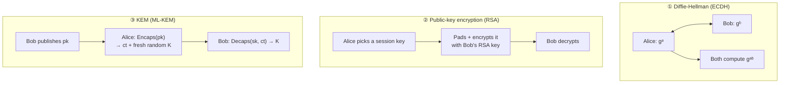
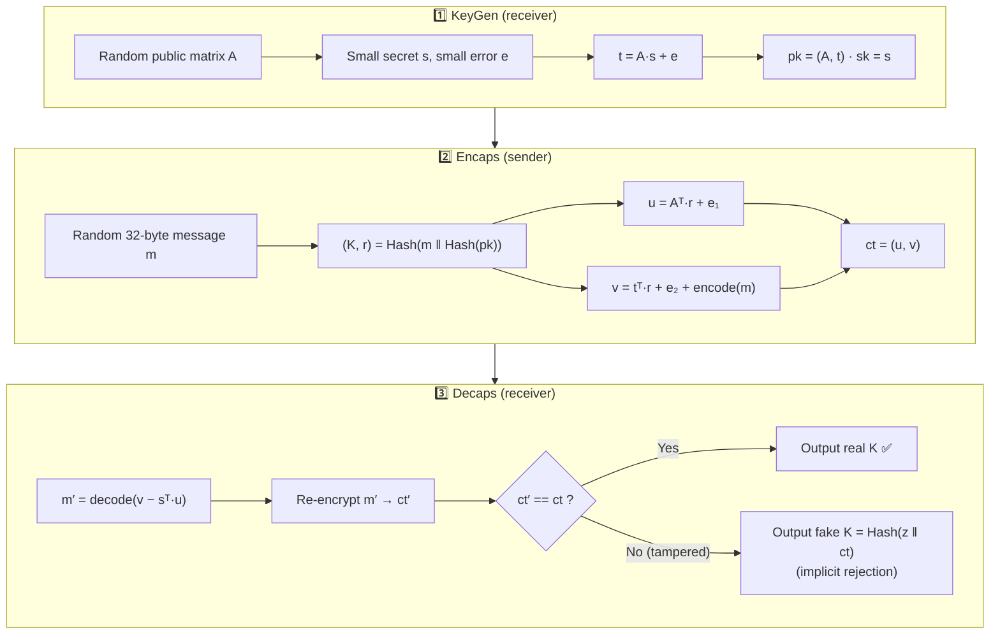
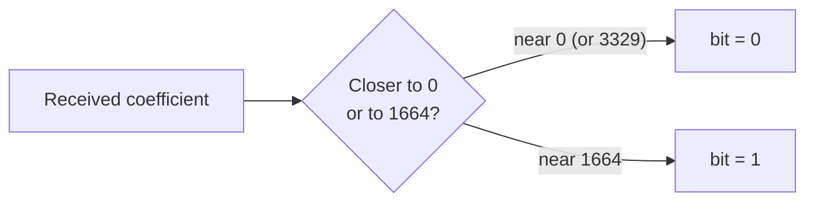
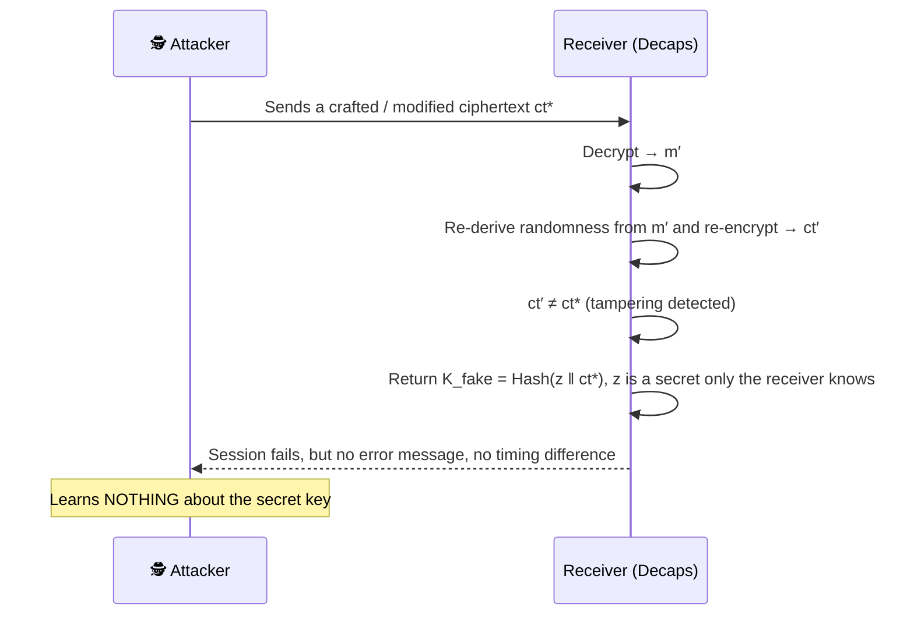

# 🔑 Key Encapsulation (KEM) and ML-KEM

[🏠 Back to index](../../README.md)  ·  **Status legend:** ✅ Recommended  ·  ⚠️ Legacy / use with care  ·  ❌ Broken / do not use

---

## Three ways to share a secret key

A KEM is the post-quantum replacement for Diffie-Hellman key exchange and for "encrypt the session key with RSA". It has exactly **three operations**:

| Operation | Who runs it | Input | Output |
|---|---|---|---|
| `KeyGen()` | Receiver | randomness | public key `pk`, secret key `sk` |
| `Encaps(pk)` | Sender | receiver's `pk` | ciphertext `ct`, shared secret `K` |
| `Decaps(sk, ct)` | Receiver | own `sk`, received `ct` | the same shared secret `K` |



The key difference from RSA encryption: in a KEM **the sender never chooses the message**. The algorithm itself generates the random secret, so there is nothing to pad, no message format to get wrong, and no attacker-chosen plaintext.

## Inside ML-KEM step by step

ML-KEM works with vectors of polynomials (256 coefficients each, modulo **q = 3329**). The parameter `k` sets the size: ML-KEM-512 (k=2), ML-KEM-768 (k=3), ML-KEM-1024 (k=4).



**Why decryption works:** substituting the formulas gives

```
v − sᵀ·u  =  encode(m)  +  (eᵀ·r + e₂ − sᵀ·e₁)
                               └──── small noise ────┘
```

Each bit of `m` is encoded as **0** (for bit 0) or **⌊q/2⌋ = 1664** (for bit 1). The noise is small, so the receiver just rounds each coefficient to whichever is nearer.



An attacker sees only `A`, `t`, `u`, `v`. Without `s` they cannot remove the `A·r` term, so `encode(m)` stays buried under a value that looks uniformly random. That's the Module-LWE problem.

<details>
<summary>🧮 Toy example with single numbers (insecure, just to see the arithmetic)</summary>

```
q = 97,  A = 23,  secret s = 3,  error e = 1
KeyGen:  t = A·s + e = 23·3 + 1 = 70            → pk = (23, 70)

Encaps bit m = 1  → encode(1) = 48  (≈ q/2)
  r = 2, e₁ = 1, e₂ = −1
  u = A·r + e₁       = 46 + 1        = 47
  v = t·r + e₂ + 48  = 140 − 1 + 48  = 187 mod 97 = 90

Decaps:
  v − s·u = 90 − 141 = −51 mod 97 = 46
  46 is close to 48 (not to 0 or 97)  → bit = 1 ✅
  (the noise was e·r + e₂ − s·e₁ = 2 − 1 − 3 = −2)
```
Real ML-KEM does this with 256 coefficients at once, in 2–4 dimensions, with secrets and noise drawn from a small centred distribution.
</details>

## The Fujisaki–Okamoto (FO) transform: what makes it tamper-proof

The basic lattice encryption above is only secure against passive eavesdroppers. ML-KEM wraps it in the **FO transform**, which makes it secure against **active attackers who send modified ciphertexts** (IND-CCA2 security):



This **implicit rejection** is a big deal: there is no "invalid ciphertext" error for an attacker to probe. Compare that with RSA PKCS#1 v1.5, where a "bad padding" error was enough to decrypt messages (Bleichenbacher 1998, ROBOT 2017).

## Why ML-KEM is robust, compared with the alternatives

| Property | RSA encryption | DH / ECDH | **ML-KEM** |
|---|---|---|---|
| Resists quantum computers | ❌ Shor | ❌ Shor | ✅ No known quantum attack on Module-LWE |
| Active-attack (CCA) security | Only with correct OAEP padding | Needs authentication on top | ✅ Built in via FO transform |
| Padding / format oracles | ❌ Historic disaster (Bleichenbacher, ROBOT) | Not applicable | ✅ No padding; implicit rejection |
| Who chooses the secret | Sender (can be weak) | Both | ✅ Algorithm-generated randomness, hashed with pk |
| Key generation cost | 🐢 Slow (prime search) | ⚡ Fast | ⚡ Very fast, so fresh keys per session are cheap |
| Encaps / decaps speed | Fast / slow | Fast | ⚡ Faster than X25519 on many CPUs |
| Constant-time implementation | Hard | Easy for X25519 | ✅ Simple integer arithmetic, no secret-dependent branching by design |
| Key + ciphertext size | ~768 B (3072-bit) | ✅ 64 B (X25519) | ⚠️ ~2.3 KB (ML-KEM-768) |
| Years of public analysis | 45+ | 45+ (25+ for ECC) | ⚠️ ~10 years of intense study |

**Honest summary:** ML-KEM is robust because it rests on a problem no known algorithm (classical or quantum) solves efficiently, and because the FO transform plus implicit rejection removes the whole class of oracle attacks that plagued RSA. Its weaknesses are larger messages and a shorter track record. Real implementations have also had timing bugs (e.g. *KyberSlash*, 2024, a secret-dependent division in some libraries), which is why **hybrid** deployment is recommended (next section).

| Parameter set | NIST level | Comparable to | Public key | Ciphertext | Decryption failure chance |
|---|---|---|---|---|---|
| ML-KEM-512 | 1 | AES-128 | 800 B | 768 B | 2⁻¹³⁹ |
| ML-KEM-768 | 3 | AES-192 | 1,184 B | 1,088 B | 2⁻¹⁶⁴ |
| ML-KEM-1024 | 5 | AES-256 | 1,568 B | 1,568 B | 2⁻¹⁷⁴ |

The decryption-failure probability (noise rounding the wrong way) is far smaller than the chance of guessing an AES key, so it is irrelevant in practice.

---

⬅️ [⚛️ Post-Quantum Cryptography: Overview](overview.md)  ·  🏠 [Index](../../README.md)  ·  [✍️ Post-Quantum Signatures](pq-signatures.md) ➡️
