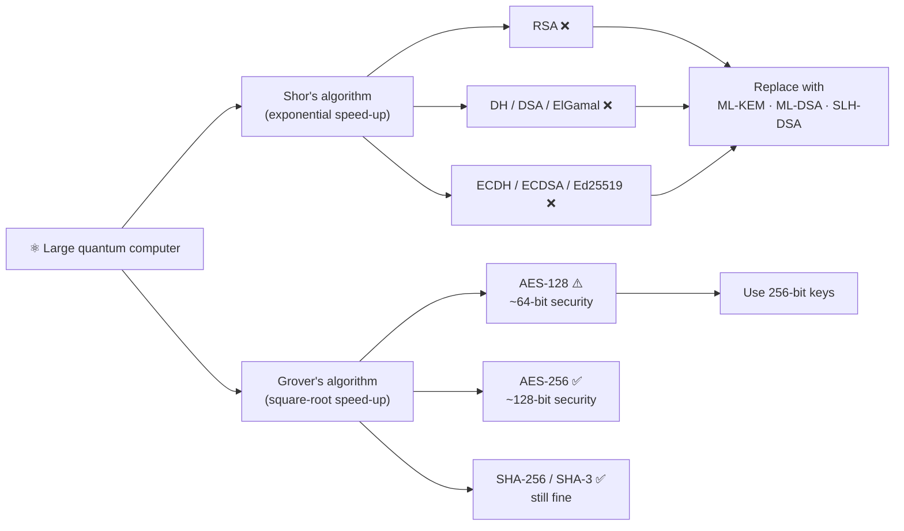
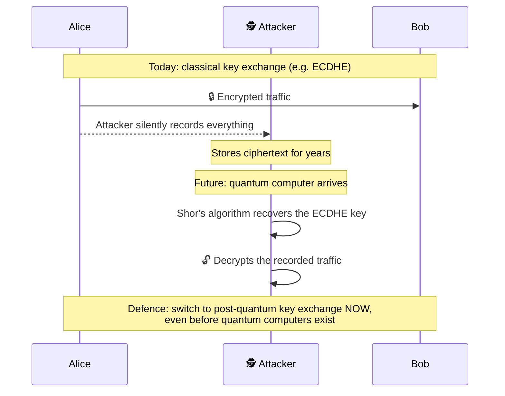
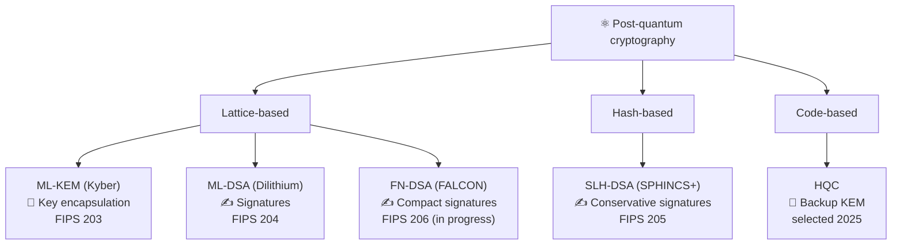
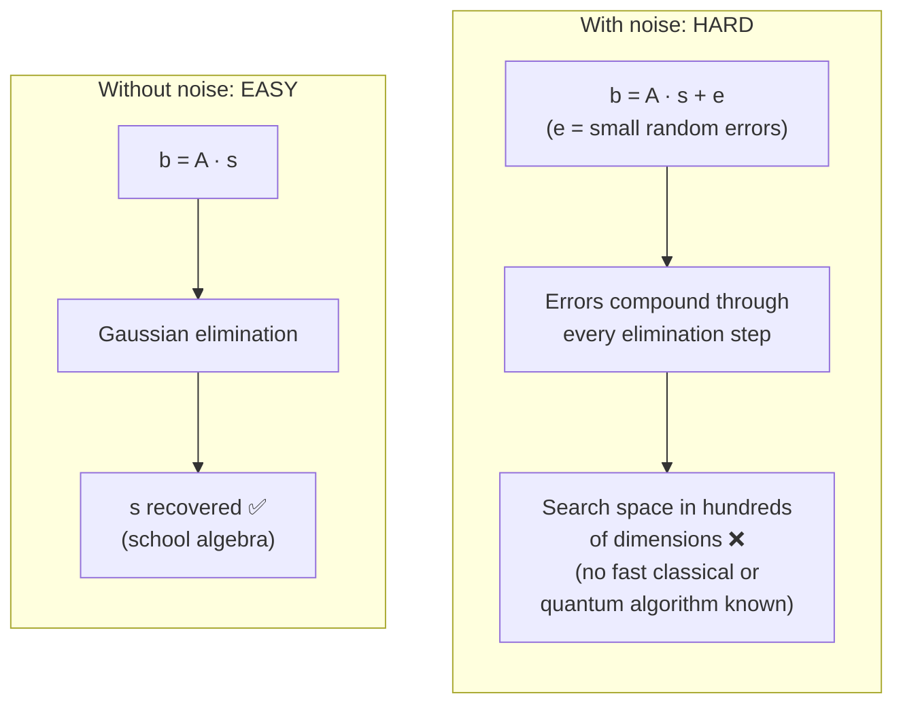

# ⚛️ Post-Quantum Cryptography: Overview

[🏠 Back to index](../../README.md)  ·  **Status legend:** ✅ Recommended  ·  ⚠️ Legacy / use with care  ·  ❌ Broken / do not use

---

A large quantum computer running **Shor's algorithm** would break RSA, DH, DSA and ECC. **Grover's algorithm** only halves symmetric security (AES-128 → about 64-bit, AES-256 → about 128-bit), so **AES-256 stays safe**.

## What a quantum computer breaks

The urgent threat is **"harvest now, decrypt later"**: adversaries recording encrypted traffic today to decrypt it once quantum computers exist.

## The post-quantum family tree

NIST finalized the first post-quantum standards in August 2024:

| Standard | Based on | Purpose | Math family | Notes |
|---|---|---|---|---|
| **ML-KEM** (FIPS 203) ✅ | CRYSTALS-Kyber | Key encapsulation | Module lattices (MLWE) | Fast, ~1 KB keys. Already deployed in browsers |
| **ML-DSA** (FIPS 204) ✅ | CRYSTALS-Dilithium | Signatures | Module lattices | General-purpose default signature |
| **SLH-DSA** (FIPS 205) ✅ | SPHINCS+ | Signatures | Hash-based | Conservative (relies only on hash security), large/slow signatures |
| **FN-DSA** (FIPS 206, in progress) | FALCON | Signatures | NTRU lattices | Smallest PQ signatures, tricky to implement |
| **HQC** (selected 2025) | HQC | Key encapsulation | Error-correcting codes | Backup KEM with different math than ML-KEM |

## How lattice crypto works: Learning With Errors (LWE)

Given a public matrix `A` and `b = A·s + e`, where `e` is a small random "error", recovering the secret `s` is the **Learning With Errors** problem.

The legitimate receiver knows `s` (the trapdoor), so the small noise can simply be rounded away. An attacker without `s` faces a needle-in-a-haystack problem. ML-KEM uses the *module* variant (MLWE), which works on small polynomial matrices to keep keys compact and fast.

---

⬅️ [ElGamal and DSA](../02-asymmetric/elgamal-and-dsa.md)  ·  🏠 [Index](../../README.md)  ·  [🔑 Key Encapsulation (KEM) and ML-KEM](ml-kem.md) ➡️
