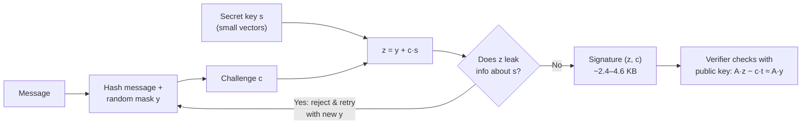
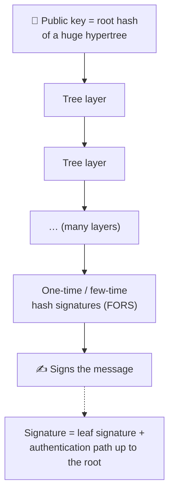
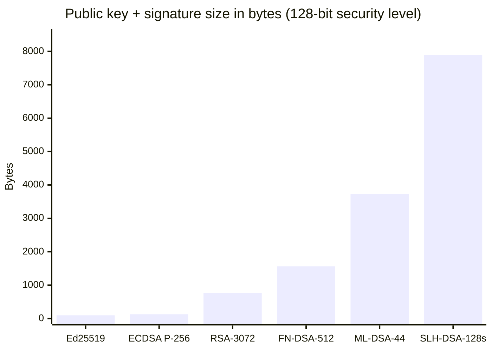

# ✍️ Post-Quantum Signatures

[🏠 Back to index](../../README.md)  ·  **Status legend:** ✅ Recommended  ·  ⚠️ Legacy / use with care  ·  ❌ Broken / do not use

---

## How ML-DSA signs: "Fiat–Shamir with aborts"

The "abort" loop is the clever part: any candidate signature that could statistically reveal the secret key is thrown away, so published signatures are independent of `s`.

## How SLH-DSA works: signatures built only from hashes

Security relies **only** on the hash function (SHA-2 / SHAKE) being secure, the most conservative assumption available. The cost is large signatures (about 8–50 KB) and slower signing.

## Size comparison: the price of quantum safety

| Algorithm | Public key | Signature / ciphertext | Quantum-safe |
|---|---|---|---|
| Ed25519 | 32 B | 64 B signature | ❌ |
| RSA-3072 | 384 B | 384 B signature | ❌ |
| X25519 | 32 B | 32 B share | ❌ |
| ML-KEM-768 | 1,184 B | 1,088 B ciphertext | ✅ |
| FN-DSA-512 | 897 B | ~666 B signature | ✅ |
| ML-DSA-44 | 1,312 B | 2,420 B signature | ✅ |
| SLH-DSA-128s | 32 B | 7,856 B signature | ✅ |

---

⬅️ [🔑 Key Encapsulation (KEM) and ML-KEM](ml-kem.md)  ·  🏠 [Index](../../README.md)  ·  [🔀 Hybrid Post-Quantum Cryptography](hybrid.md) ➡️
