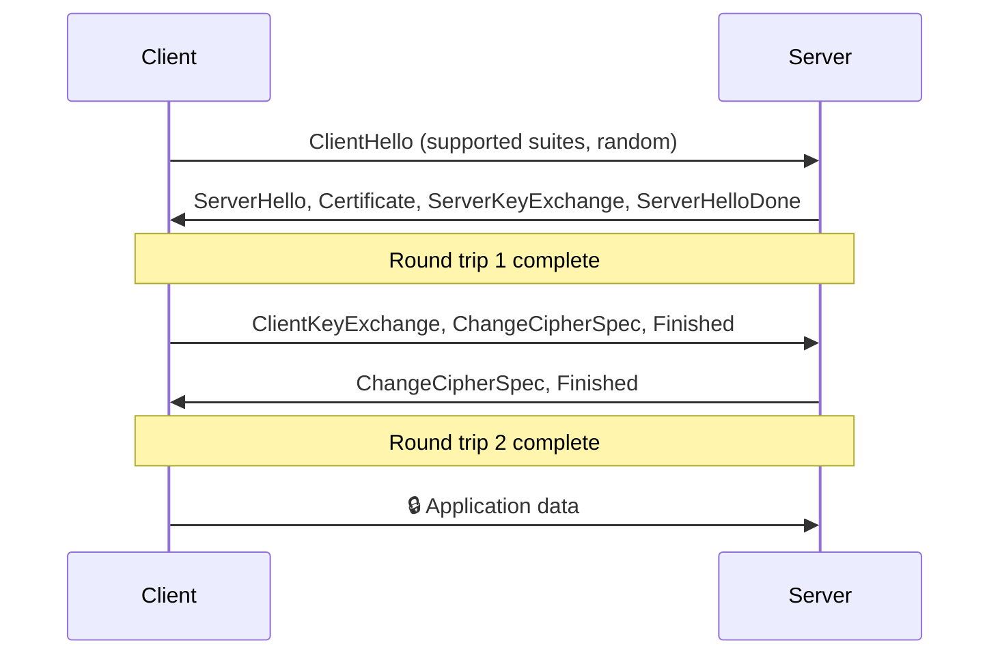
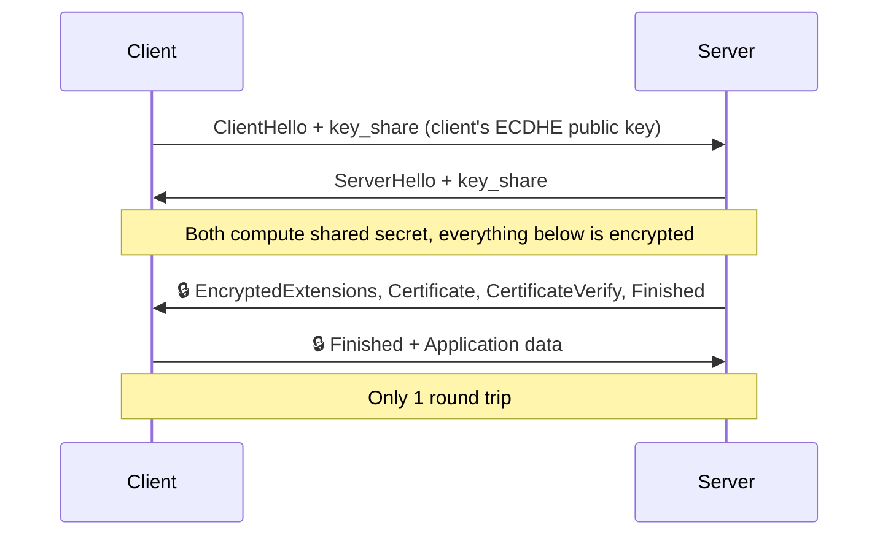

# 🌐 TLS 1.2 vs TLS 1.3

[🏠 Back to index](../README.md)  ·  **Status legend:** ✅ Recommended  ·  ⚠️ Legacy / use with care  ·  ❌ Broken / do not use

---

TLS uses **asymmetric crypto** to authenticate the server and agree on keys, then **symmetric crypto** for the data.

## TLS 1.2 (RFC 5246, 2008)

- **Handshake takes 2 round trips (2-RTT)** before application data flows.
- **Cipher suites bundle everything**, e.g. `TLS_ECDHE_RSA_WITH_AES_128_GCM_SHA256` = key exchange (ECDHE) + authentication (RSA) + cipher (AES-128-GCM) + hash (SHA-256).
- **Allows static RSA key exchange**, where the client encrypts the secret with the server's RSA key. ❌ No forward secrecy: steal the key, decrypt all recorded traffic.
- **Permits weak options:** CBC modes, RC4, 3DES, SHA-1, export ciphers. These were the root of attacks like BEAST, POODLE, Lucky13, FREAK and Logjam.
- **Certificate sent in plaintext** during the handshake.
- Still secure **if configured carefully** (ECDHE + AEAD suites only).

## TLS 1.3 (RFC 8446, 2018)

- **Handshake takes 1 round trip (1-RTT)**; resumed sessions can send data immediately with **0-RTT** (⚠️ 0-RTT data can be replayed, so only use it for idempotent requests).
- **Forward secrecy is mandatory:** only ephemeral (EC)DHE key exchange; static RSA key exchange is gone.
- **Only AEAD ciphers**, just five suites:
  - `TLS_AES_128_GCM_SHA256`
  - `TLS_AES_256_GCM_SHA384`
  - `TLS_CHACHA20_POLY1305_SHA256`
  - `TLS_AES_128_CCM_SHA256`
  - `TLS_AES_128_CCM_8_SHA256`
- **Removed:** RC4, 3DES, CBC modes, MD5, SHA-1, compression, renegotiation, static RSA/DH, custom DH groups.
- **Encrypts most of the handshake**, including the server certificate, right after ServerHello.
- **Key schedule uses HKDF**; signatures use RSA-PSS, ECDSA or EdDSA.
- Supports **hybrid post-quantum** key exchange (`X25519MLKEM768`) via extensions.

## Side by side

| Feature | TLS 1.2 | TLS 1.3 |
|---|---|---|
| Handshake latency | 2-RTT | 1-RTT (0-RTT on resumption) |
| Forward secrecy | Optional | Mandatory |
| Key exchange | RSA, DH, DHE, ECDH, ECDHE | DHE, ECDHE (+ hybrid PQ) |
| Bulk ciphers | Many, incl. CBC, RC4, 3DES | AEAD only (AES-GCM, ChaCha20-Poly1305, AES-CCM) |
| Cipher suites | 300+ combinations | 5 |
| Certificate privacy | Sent in clear | Encrypted |
| Downgrade protection | Weak | Built-in |
| Known attack history | BEAST, POODLE, Lucky13, FREAK, Logjam, ROBOT | None of these apply |

---

⬅️ [🧩 Supporting Primitives: Hashes, MACs, KDFs](04-supporting-primitives.md)  ·  🏠 [Index](../README.md)  ·  [📊 Comparisons and Recommendations](06-comparisons.md) ➡️
